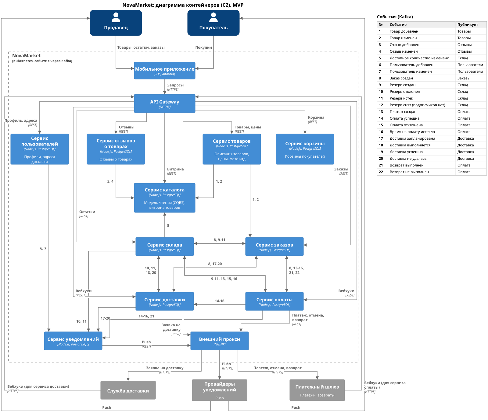

# Диаграмма контейнеров (C2)

[c2.puml](c2.puml)

- События на схеме нарисованы стрелками от сервиса, который их публикует, к сервису, который их читает.
- Чтобы схема хоть как-то читалась, на стрелках стоят номера событий, расшифровка указана в таблице справа.
- Стрелка с двумя концами значит, что сервисы обмениваются событиями в обе стороны.

## Принятые решения, которые нужно учитывать

- Клиенты и API Gateway:
    - Покупатель и продавец работают в одном мобильном приложении, его запросы идут через API Gateway (NGINX).
    - Через него же приходят вебхуки платежного шлюза и службы доставки (передаются в сервисы оплаты и доставки).
- Внешний прокси:
    - В платежный шлюз, службу доставки и провайдеры уведомлений сервисы ходят через внешний прокси (NGINX).
- Хореография:
    - Все наши сервисы взаимодействуют асинхронно. Обмениваются событиями через Kafka.
    - Топики заведены на сущности, ключ партиции - id сущности. Kafka сохраняет порядок внутри партиции, поэтому события одной сущности приходят подписчику по порядку.
    - Сервис сохраняет событие в своей базе в той же транзакции, что и свои данные, и только потом отправляет в Kafka (Transactional Outbox).
    - Обработанные события сервис запоминает в таблице inbox, чтобы не обработать повтор (Transactional Inbox).
- CQRS и репликация данных:
    - Сервис каталога собирает собственную модель для чтения из событий товаров, отзывов и склада (паттерн CQRS).
    - Сервис заказов держит у себя копию цен из событий товаров и сам считает сумму заказа (чтобы не делать синхронный запрос к сервису товаров).
    - Сервис уведомлений держит у себя частичную информацию о пользователях (чтобы не делать синхронных запросов к сервису пользователей).

## События вне Saga

События 1-7 не участвуют в оформлении заказа, остальные описаны в [реестре Saga](saga.md).

| № | Событие | Название | Публикует | Потребляют | Топик |
| :- | :- | :- | :- | :- | :- |
| 1 | Товар добавлен | ProductAdded | Товары | Каталог, Заказы | products |
| 2 | Товар изменен | ProductUpdated | Товары | Каталог, Заказы | products |
| 3 | Отзыв добавлен | ReviewAdded | Отзывы | Каталог | reviews |
| 4 | Отзыв изменен | ReviewUpdated | Отзывы | Каталог | reviews |
| 5 | Доступное количество изменено | AvailabilityChanged | Склад | Каталог | availability |
| 6 | Пользователь добавлен | UserAdded | Пользователи | Уведомления | users |
| 7 | Пользователь изменен | UserUpdated | Пользователи | Уведомления | users |
