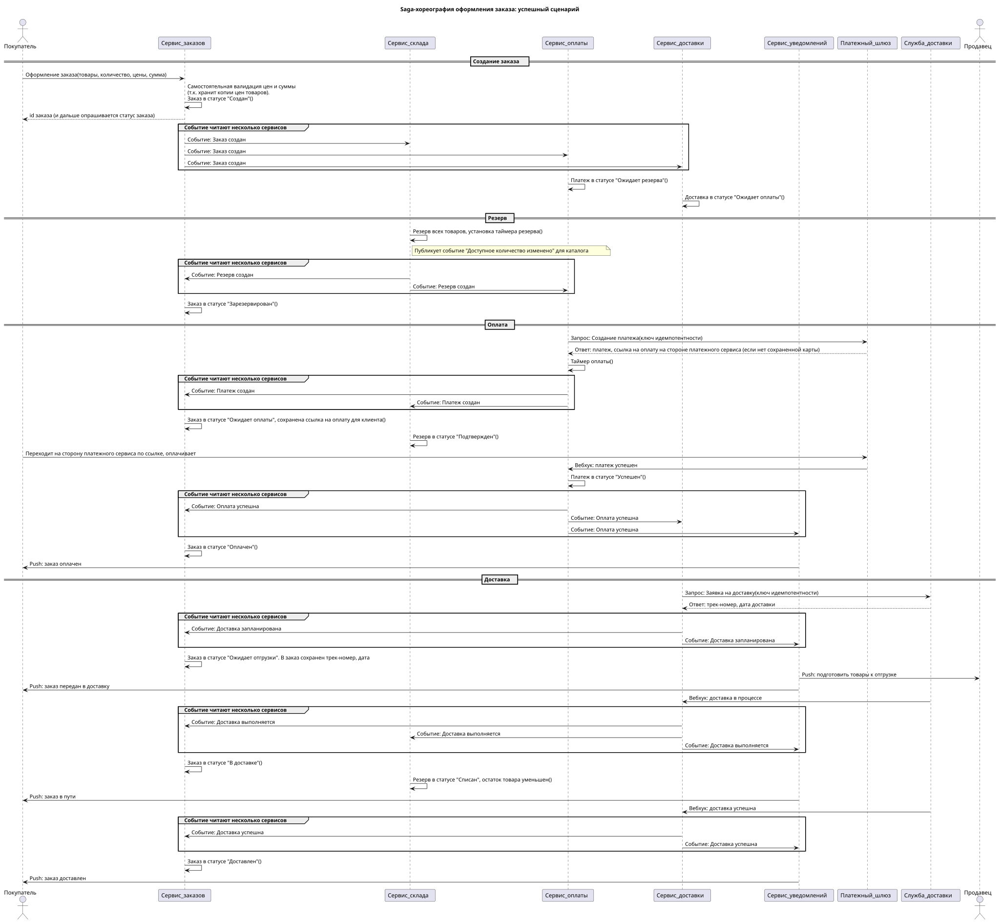
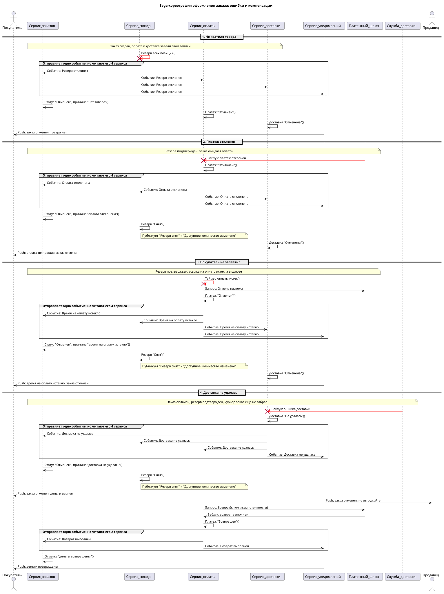

# Saga-хореография оформления заказа

Успешный сценарий: [saga-success.puml](saga-success.puml)

Ошибки и компенсации (нет товара, платеж отклонен, покупатель не заплатил, доставка не удалась): [saga-failures.puml](saga-failures.puml)

## Реестр событий

| № | Этап | Тип события | Название | Публикует | Потребляют | Топик |
| :- | :- | :- | :- | :- | :- | :- |
| 8 | Заказ создан | domain | OrderCreated | Заказы | Склад, Оплата, Доставка | orders |
| 9 | Товары зарезервированы | domain | ReservationCreated | Склад | Заказы, Оплата | reservations |
| 10 | Не хватило товара | failure | ReservationRejected | Склад | Заказы, Оплата, Доставка, Уведомления | reservations |
| 11 | Резерв истек до начала оплаты | timeout | ReservationExpired | Склад | Заказы, Оплата, Доставка, Уведомления | reservations |
| 12 | Резерв снят | compensation | ReservationReleased | Склад | пока никто, нужен для мониторинга | reservations |
| 13 | Платеж создан, ждем оплату | domain | PaymentCreated | Оплата | Заказы, Склад | payments |
| 14 | Успешная оплата | domain | PaymentSucceeded | Оплата | Заказы, Доставка, Уведомления | payments |
| 15 | Платеж отклонен | failure | PaymentFailed | Оплата | Заказы, Склад, Доставка, Уведомления | payments |
| 16 | Время на оплату истекло | timeout | PaymentTimedOut | Оплата | Заказы, Склад, Доставка, Уведомления | payments |
| 17 | Доставка запланирована | domain | DeliveryScheduled | Доставка | Заказы, Уведомления | deliveries |
| 18 | Курьер забрал заказ | domain | DeliveryStarted | Доставка | Заказы, Склад, Уведомления | deliveries |
| 19 | Заказ доставлен | domain | DeliverySucceeded | Доставка | Заказы, Уведомления | deliveries |
| 20 | Доставка не удалась | failure | DeliveryFailed | Доставка | Заказы, Склад, Оплата, Уведомления | deliveries |
| 21 | Возврат средств | compensation | RefundSucceeded | Оплата | Заказы, Уведомления | payments |
| 22 | Возврат не прошел | failure | RefundFailed | Оплата | Заказы | payments |

## Таймауты

| Таймер | Кто ставит | Зачем | Событие |
| :- | :- | :- | :- |
| Резерв, 15 минут | Склад | платеж так и не создали, например шлюз недоступен | ReservationExpired |
| Оплата, дольше срока жизни ссылки в шлюзе | Оплата | покупатель ушел со страницы оплаты | PaymentTimedOut |
