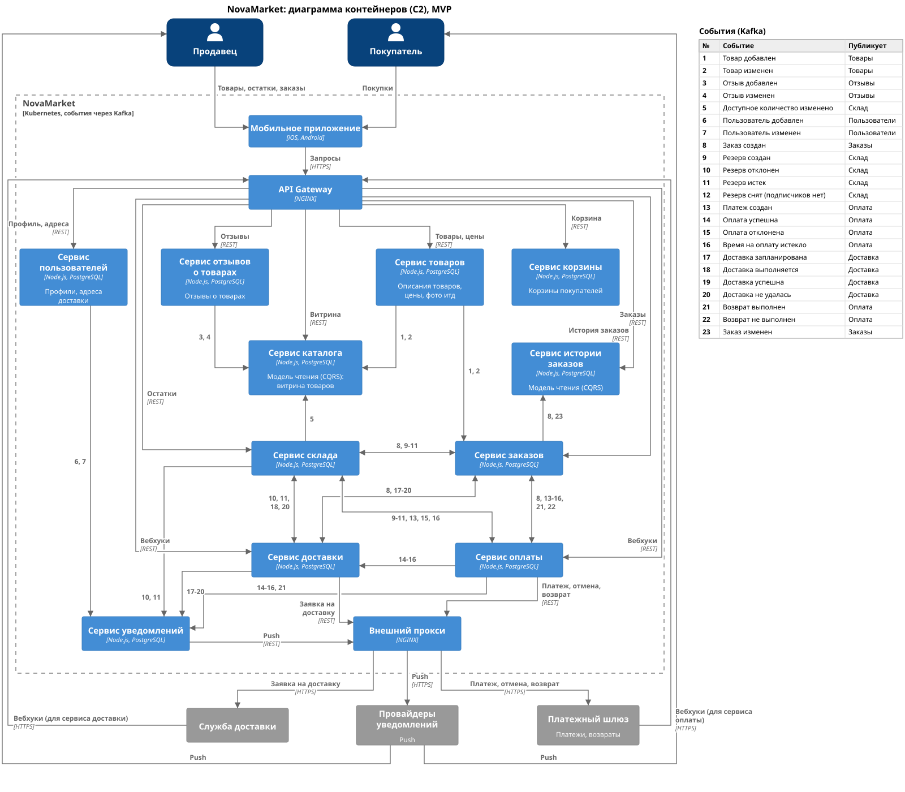

### **Название задачи:** История заказов покупателя
### **Автор:** Андрей Чигиринский
### **Дата:** 2026-10-29

### **Функциональные требования**

| № | Действующие лица или системы | Use Case | Описание |
| :-: | :- | :- | :- |
| 1 | Покупатель | Список заказов | Все заказы покупателя: сумма, дата, способ доставки |
| 2 | Покупатель | Карточка заказа | Товары, количество и цена, итог, способ доставки и оплаты, финальный статус (доставлен, отменен) |
| 3 | Покупатель, платежный шлюз | Скачать чек | Ссылка на чек, который выдал платежный шлюз |
| 4 | Покупатель | Оставить отзыв | Отзыв о товаре уходит в сервис отзывов |
| 5 | Покупатель | Заказать снова | Товары заказа добавляются в корзину, дальше обычное оформление по текущим ценам |

### **Нефункциональные требования**

| № | Требование |
| :-: | :- |
| 1 | Отклик до 1 с на p99.99 и до 0,3 с на p98 |
| 2 | 2 500 заказов в день на старте, 40 000+ через год, история хранится годами |
| 3 | Тот же API используют новые каналы (веб, чат-бот) |
| 4 | Работа в нескольких регионах |

### **Решение**

[c2.puml](c2.puml)

Выбран CQRS: отдельный сервис истории заказов со своей базой, данные в нее приходят событиями.

1. Сервис заказов уже и так знает почти все о заказе. Недостающие способ оплаты и ссылку на чек он получает из событий оплаты 13 и 14, в них добавлены эти поля.
2. При каждом изменении заказа сервис заказов публикует новое событие 23 "Заказ изменен" с информацией по заказу (топик orders).
3. Сервис истории по событиям 8 и 23 хранит заказ одним документом (JSONB) для удобства (нужен еще индекс по покупателю и дате).
4. Покупатель получает историю через API Gateway.
5. Чек заказа открывается по ссылке у платежного провайдера.
6. Отзыв на товар пользователь пишет в сервис отзывов.
7. При нажатии на "Заказать снова" товары из заказа кладутся в корзину, а далее уже существующий флоу оформления заказа.

### **Обоснование**

- Чтобы получить данные истории заказов, достаточно одного чтения из одной базы, без вызовов других сервисов, поэтому отклик укладывается в требования.
- История открывается, даже если сервисы оплаты или доставки недоступны.
- Чтение истории не нагружает базу оформления заказов, сервис истории масштабируется отдельно.
- При росте и нескольких регионах базу истории можно шардировать по региону покупателя.

### **Альтернативы**

- API Composition: на каждый запрос собирать данные из сервисов заказов и оплаты. Новой базы тогда нет, но запрос - это несколько вызовов, история не открывается при сбое сервиса оплаты, а чтения нагружают сервис заказов.
- Event Sourcing: хранить заказ как цепочку событий и строить историю проекцией. Дает полную историю изменений и пересборку из журнала, но для показа финального статуса это лишняя сложность (журнал, пересчеты, снепшоты).
- Таблица истории внутри сервиса заказов: меньше компонентов, но чтение истории и оформление заказов делят базу и масштабируются вместе, что может негативно повлиять на оформление заказа (а это критичный путь).

**Недостатки, ограничения, риски**

- История обновляется с некоторой задержкой (eventual consistency).
- Данные заказа хранятся дважды.
- Для пересборки модели нужен перелив данных из сервиса заказов.
- 40 000 заказов в день - около 15 млн документов в год, нужно шардирование по региону и, со временем, архив старых заказов.
